# VM Setup, Network Configuration, Service Enumeration & Detection


## Objective

Configure a virtual network, verify communication between lab hosts, enumerate services on a deliberately vulnerable VM, and then examine the security telemetry and alerts that the scan produced.

## Lab Environment

| Host | Role | Address |
|---|---|---|
| Kali Linux | Attacker / scanning workstation | `eth0` 10.0.2.6 (NAT, DHCP) · `eth1` **10.10.1.10/24** (intnet, static) |
| Metasploitable 2 | Intentionally vulnerable target | `eth0` **10.10.1.20/24** (intnet) |
| SIEMv2 | Monitoring (Suricata, Kibana, Arkime) | NAT adapter 10.0.2.4/24 during verification; second adapter on intnet in promiscuous mode |

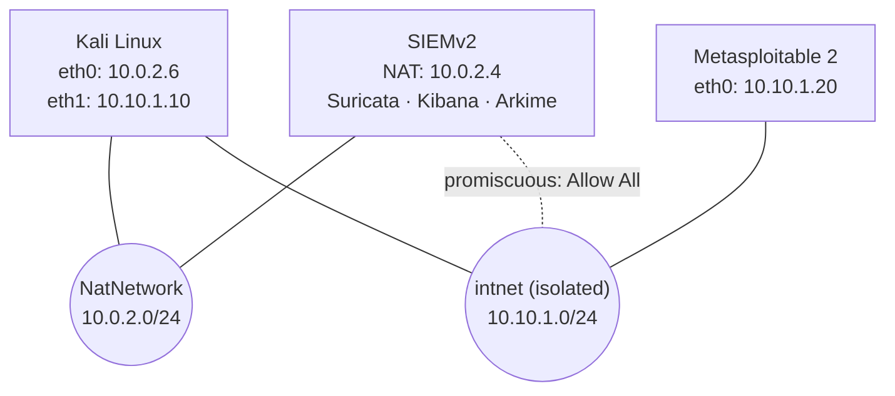

Kali scans Metasploitable across the isolated `intnet`. The SIEM's second adapter sits on the same `intnet` with promiscuous mode set to **Allow All**, so it can see the traffic between the other two hosts.

## Walkthrough

### Step 1: VM files and workspace
VM folders organized in the VirtualBox VM directory. (They are on the `C:` drive rather than the `D:` drive named in the original activity.)

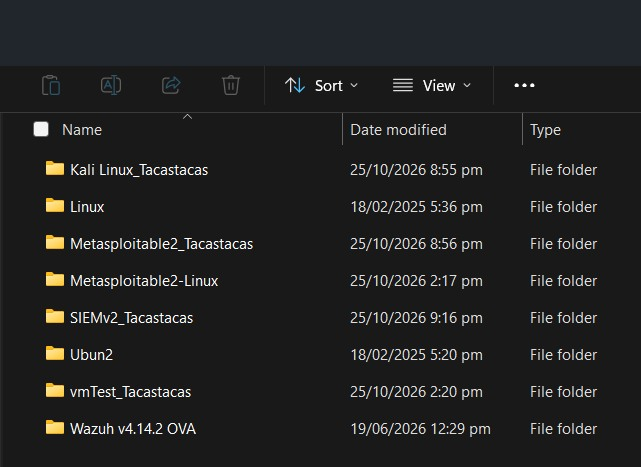

### Step 3: VirtualBox Manager
Kali, Metasploitable 2, and SIEMv2 created and configured in Oracle VirtualBox.

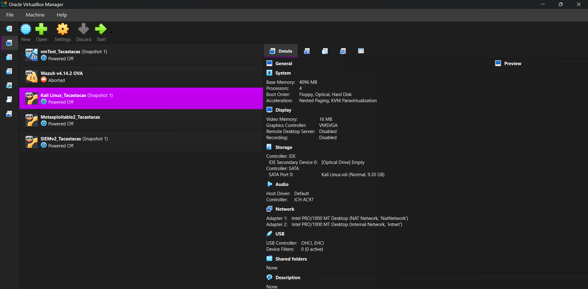

### Step 4: Kali network adapters
Adapter 1 on **NAT Network**, Adapter 2 on the isolated internal network **intnet**.

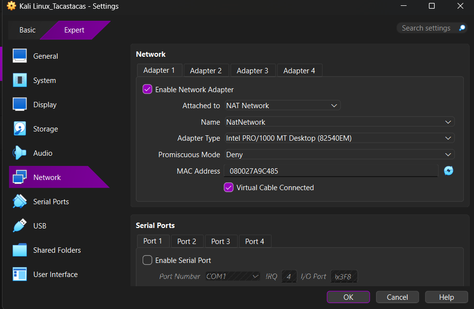
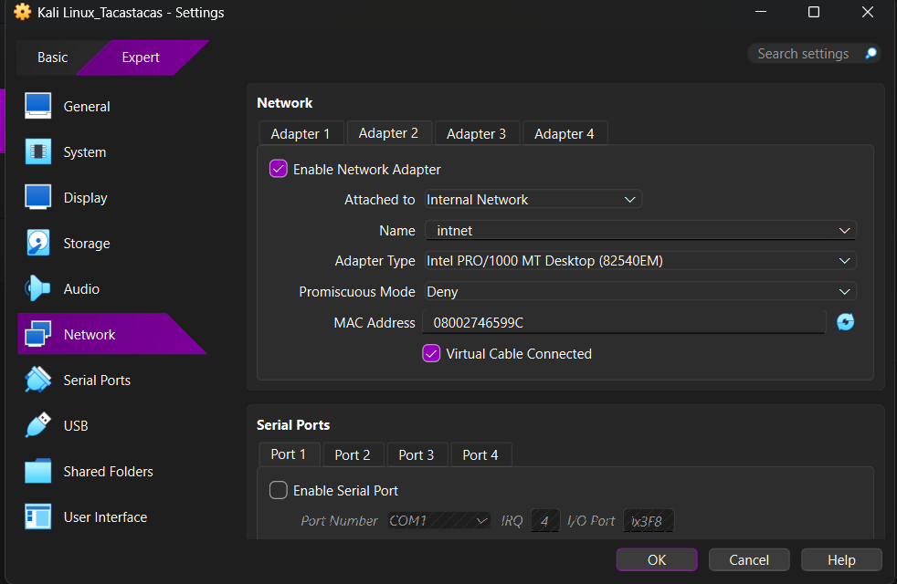

### Step 5: Metasploitable virtual disk and network
`Metasploitable.vmdk` attached, Adapter 1 on **intnet**.

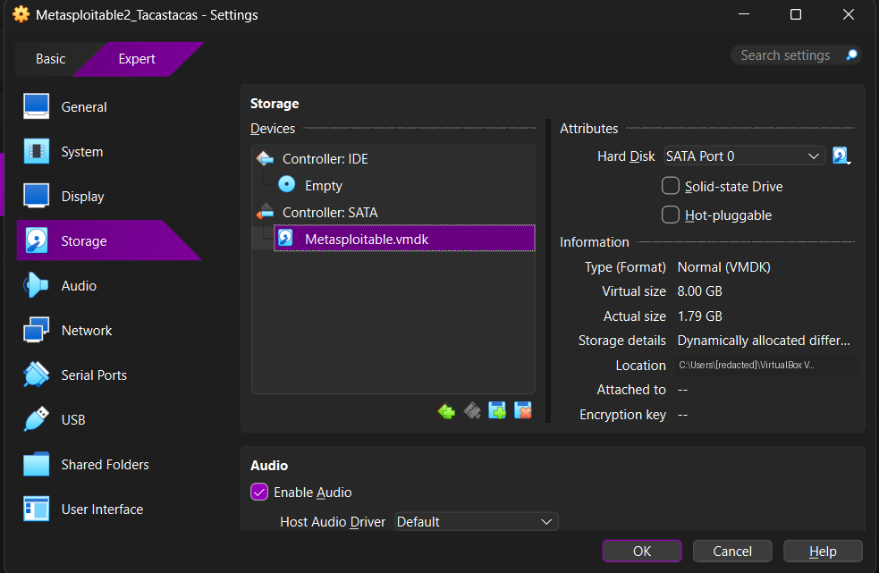
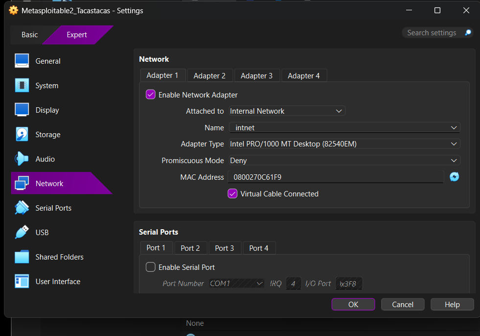

### Step 6: SIEMv2 network configuration
Adapter 1 on NAT Network, Adapter 2 on **intnet** with promiscuous mode **Allow All** for network monitoring.


### Step 7: Kali static interface address
Verified with `ip -4 addr`: `eth1` has the static address **10.10.1.10/24**.

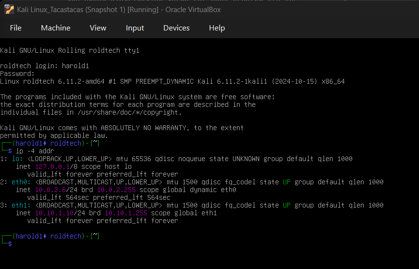

### Step 8: Metasploitable IP address
Verified with `ifconfig eth0`: **10.10.1.20/24**.

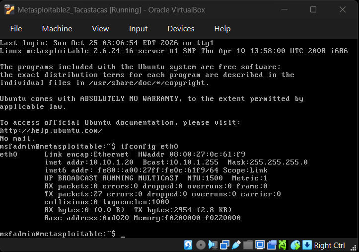

### Steps 9 & 10: Connectivity and Nmap service-version scan
`ping -c 4 10.10.1.20` returned 4/4 replies (0% packet loss), then a service-version scan was run against the target.

```bash
ping -c 4 10.10.1.20
nmap -sV 10.10.1.20
```

> In the screenshot the scan was typed as `nmap -s$(printf '\126') 10.10.1.20`. The shell expands `printf '\126'` to `V`, so this is the same as `nmap -sV`.

The scan found **23 open TCP ports** (977 closed), completing in about 23 seconds.

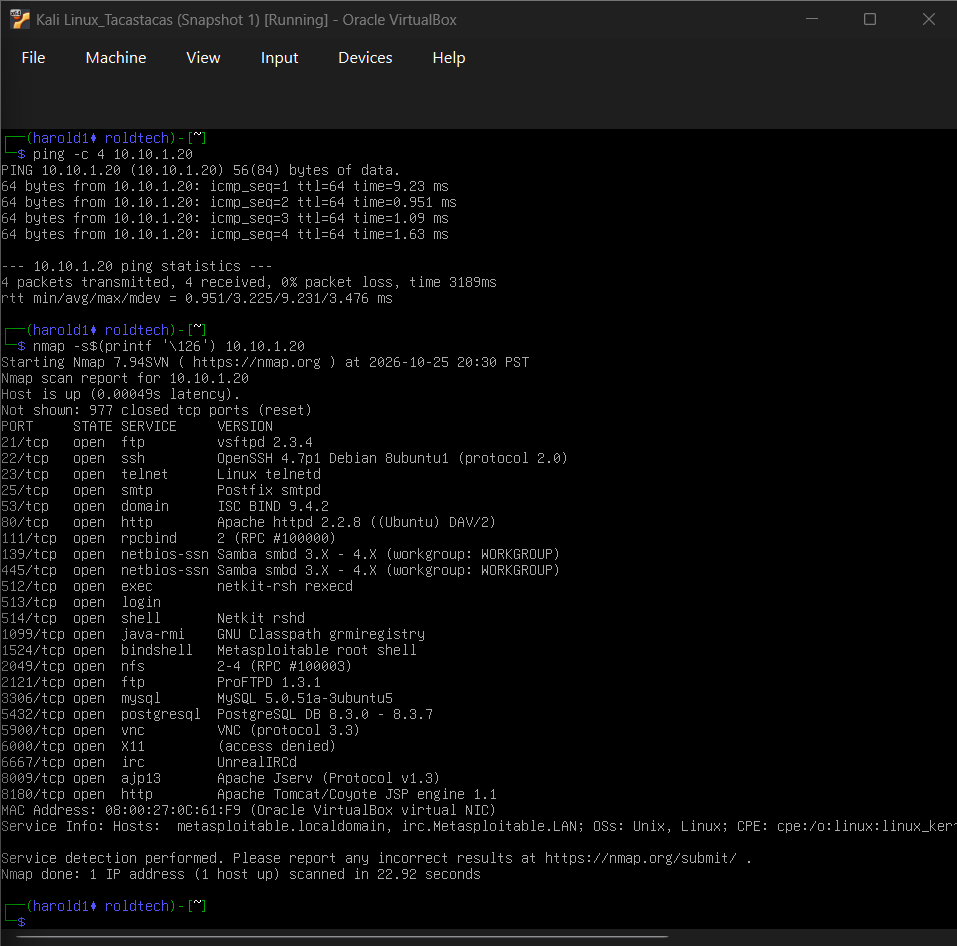

### Step 11A: Kibana access and captured events
Kibana Discover on the `filebeat-*` data view confirmed Suricata ingested traffic from 10.10.1.10 to 10.10.1.20.

```
event.module: "suricata" AND (source.ip: "10.10.1.20" OR destination.ip: "10.10.1.20")
```

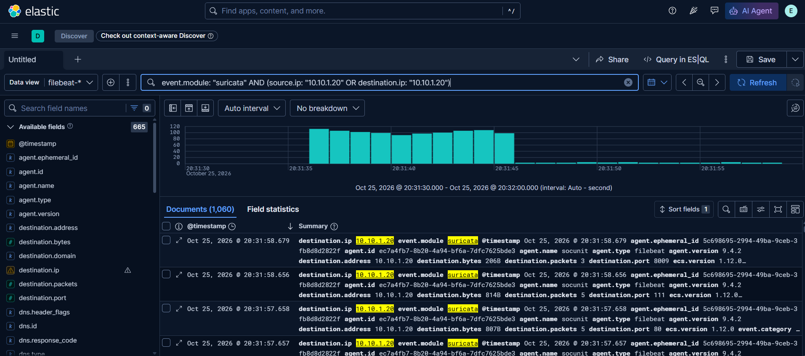

### Step 11B: Suricata scan alert
Filtering to alert events around the scan time returned **8 alerts**. The signature is **ET SCAN Possible Nmap User-Agent Observed (SID 2024364)**.

```
event.module: "suricata" AND suricata.eve.event_type: "alert"
```

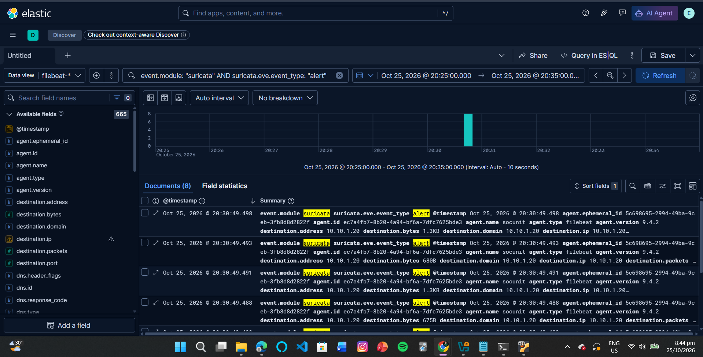
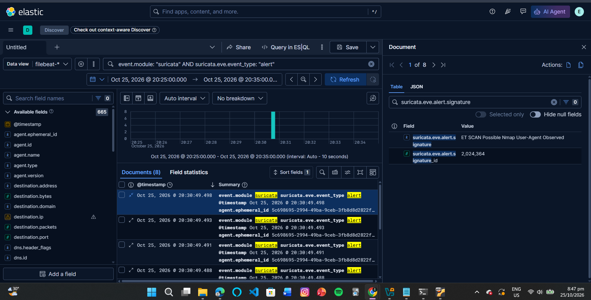

### Step 11C: Arkime captured sessions
Arkime showed **1,055 sessions** between the two lab hosts, including TCP/HTTP traffic to ports 80 and 8180.

```
ip == 10.10.1.10 && ip == 10.10.1.20
```

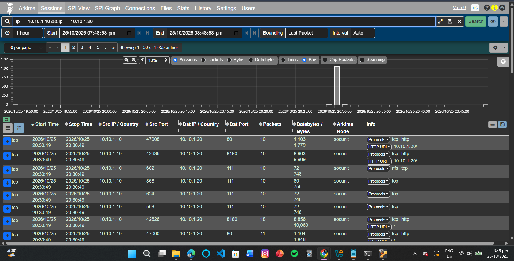

## Findings: Open Services on 10.10.1.20

| Port | Service | Version |
|---|---|---|
| 21/tcp | ftp | vsftpd 2.3.4 |
| 22/tcp | ssh | OpenSSH 4.7p1 Debian 8ubuntu1 |
| 23/tcp | telnet | Linux telnetd |
| 25/tcp | smtp | Postfix smtpd |
| 53/tcp | domain | ISC BIND 9.4.2 |
| 80/tcp | http | Apache httpd 2.2.8 (Ubuntu) DAV/2 |
| 111/tcp | rpcbind | 2 (RPC #100000) |
| 139/tcp | netbios-ssn | Samba smbd 3.X - 4.X |
| 445/tcp | netbios-ssn | Samba smbd 3.X - 4.X |
| 512/tcp | exec | netkit-rsh rexecd |
| 513/tcp | login | |
| 514/tcp | shell | Netkit rshd |
| 1099/tcp | java-rmi | GNU Classpath grmiregistry |
| 1524/tcp | bindshell | Metasploitable root shell |
| 2049/tcp | nfs | 2-4 (RPC #100003) |
| 2121/tcp | ftp | ProFTPD 1.3.1 |
| 3306/tcp | mysql | MySQL 5.0.51a-3ubuntu5 |
| 5432/tcp | postgresql | PostgreSQL DB 8.3.0 - 8.3.7 |
| 5900/tcp | vnc | VNC (protocol 3.3) |
| 6000/tcp | X11 | (access denied) |
| 6667/tcp | irc | UnrealIRCd |
| 8009/tcp | ajp13 | Apache Jserv (Protocol v1.3) |
| 8180/tcp | http | Apache Tomcat/Coyote JSP engine 1.1 |

## Detection Summary

| Source | What it showed |
|---|---|
| Nmap (Kali) | 23 open TCP ports, service versions identified |
| Suricata → Kibana | 8 alerts, signature **ET SCAN Possible Nmap User-Agent Observed (SID 2024364)** |
| Suricata → Kibana | Network events for 10.10.1.20 on the `filebeat-*` data view |
| Arkime | 1,055 sessions between 10.10.1.10 and 10.10.1.20, including HTTP to ports 80 and 8180 |

The same scan was visible from the attacker side (Nmap output) and the defender side (Suricata alerts plus Arkime session records), all within the same time window (about 20:30 on 2026-10-25).

## Written Answers

**1. What command did I use to set the static IP on the second interface?**
`sudo ip addr add 10.10.1.10/24 dev eth1`, then I saved the static settings in `/etc/network/interfaces` so they persist across reboots.

**2. What does PROMISC mean?**
Promiscuous mode. It lets a network interface receive frames addressed to other devices when the virtual network delivers them. I set SIEMv2 Adapter 2 to **Allow All** so it can monitor the traffic on `intnet`.

**3. What are three open ports shown in the Nmap scan?**
21/tcp (FTP, vsftpd 2.3.4), 22/tcp (SSH, OpenSSH 4.7p1), and 80/tcp (HTTP, Apache httpd 2.2.8).

**4. What alert signature appeared for my Nmap scan?**
Suricata alert **ET SCAN Possible Nmap User-Agent Observed**, signature ID **2024364**, in Kibana Discover.

## Skills Demonstrated

- Virtual network design with NAT Network and isolated internal networks
- Static IP configuration on Linux and connectivity verification (`ip`, `ifconfig`, `ping`)
- Port scanning and service-version enumeration with Nmap
- Promiscuous-mode traffic capture for network monitoring
- Alert triage and log searching in Kibana (Suricata EVE events)
- Packet and session analysis in Arkime
- Correlating attacker activity with defensive telemetry

## Full Report

The original write-up with all evidence is in [`report/Day1_Installation_Complete.pdf`](./report/Day1_Installation_Complete.pdf). Step 2 is intentionally excluded from the evidence.

## Responsible Use

This lab was run entirely on isolated virtual machines I own. Metasploitable 2 is intentionally vulnerable and must never be exposed to a real network.
